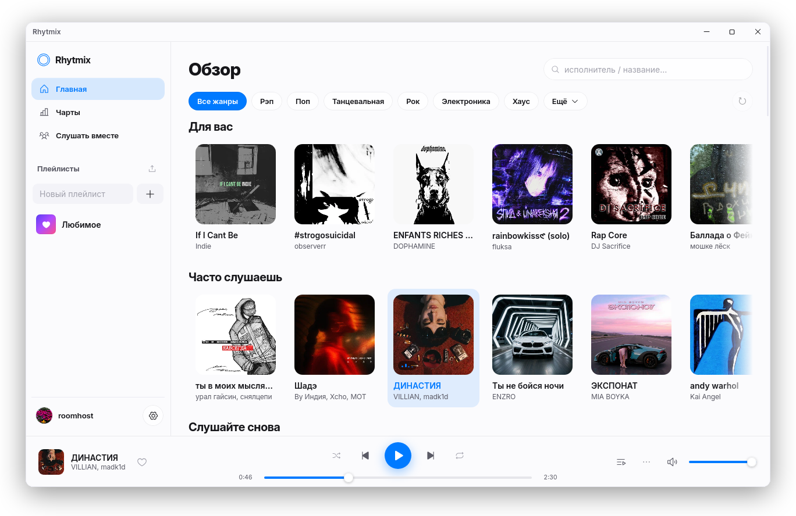
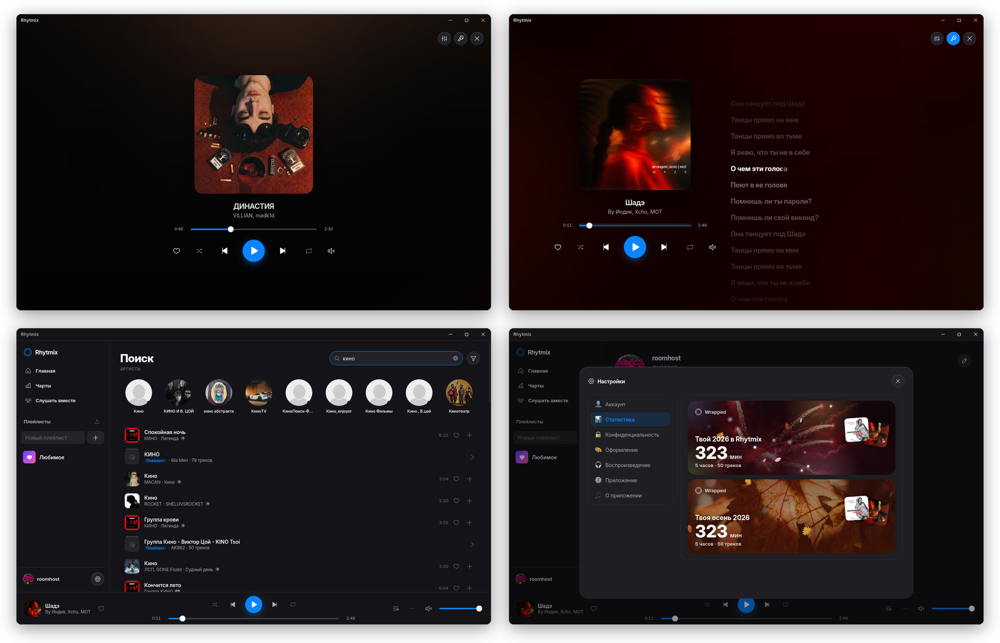

# Rhytmix

Десктопный плеер: поиск и прослушивание из YouTube, SoundCloud, Spotify и
Яндекс.Музыки в одном приложении.

<picture>
  <source media="(prefers-color-scheme: dark)" srcset="docs/preview-dark.png">
  
</picture>

## Возможности

- **Поиск по всем источникам сразу** — YouTube, SoundCloud, Spotify и Яндекс.Музыка из одной строки; можно найти песню по строчке из текста
- **Тексты песен** с подсветкой по словам, как в караоке
- **Лайки и плейлисты**, импорт плейлистов по ссылке из SoundCloud и Spotify
- **Рекомендации** по прослушанному, мировые и региональные чарты, жанры
- **Звук** — 10-полосный эквалайзер с пресетами, плавный переход между треками, выравнивание громкости, таймер сна
- **Оформление** — светлая и тёмная темы, свой акцент и фон, магазин тем
- **Итоги** месяца, сезона и года — топ треков и артистов, любимый жанр, картинкой
- **Друзья** — профили, подписки, «что сейчас играет»
- **Слушать вместе** — комната по коду: друзья слышат то же, что и вы, синхронно
- Медиа-клавиши, системный виджет плеера, трей, статус в Discord
- Встроенное обновление

## Установка

| ОС | Файл | Примечание |
|----|------|------------|
| **Windows** | `Rhytmix_<версия>_x64-setup.exe` | обычный установщик |
| **macOS** | `Rhytmix_<версия>_universal.dmg` | при первом запуске macOS скажет, что не может проверить приложение: **Системные настройки → Конфиденциальность и безопасность → Всё равно открыть** |
| **Linux** | `.AppImage`, `.deb` или `.rpm` | AppImage нужно сделать исполняемым: `chmod +x` |
| **Arch Linux** | `rhytmix-app_<версия>_x86_64-linux.tar.gz` | распаковать и запустить `./rhytmix-app` либо `sudo ./install.sh`; зависимости: `pacman -S webkit2gtk-4.1 alsa-lib`. Обновляется вручную |

### [⬇ Скачать последнюю версию](https://github.com/salenyo/rhytmix-releases/releases/latest)

## Обновления

Приложение проверяет обновления при запуске и ставит их в один клик — приходят только стабильные
релизы. Ночные сборки (`1.0.0-nightly.42`, помечены как Pre-release) ставятся вручную со страницы
релизов: новое в них появляется раньше, но бывают ошибки.

## Аккаунт

Регистрация открыта — достаточно придумать логин и пароль. Аккаунт общий с
[мобильной версией](https://github.com/salenyo/lamusica-mobile-releases): лайки, плейлисты и история
синхронизируются.

---

Мобильная версия — [lamusica-mobile-releases](https://github.com/salenyo/lamusica-mobile-releases).

Нашли проблему или есть идея — [заведите issue](https://github.com/salenyo/rhytmix-releases/issues).

